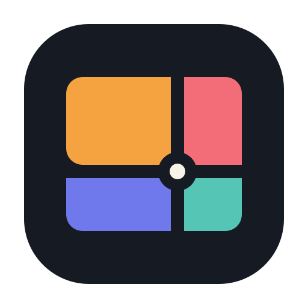
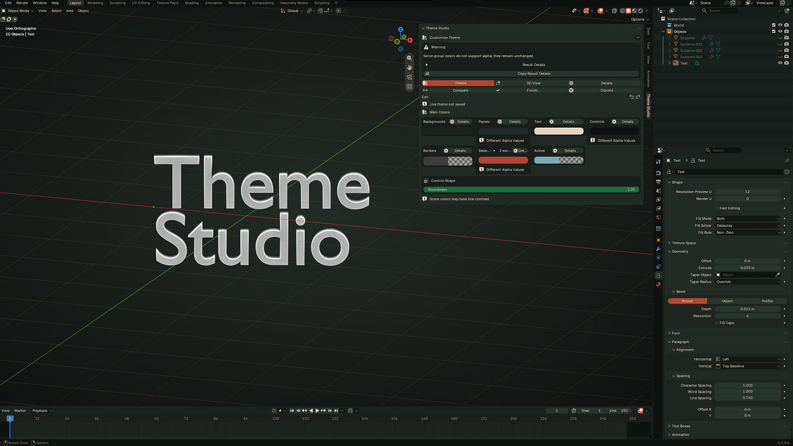
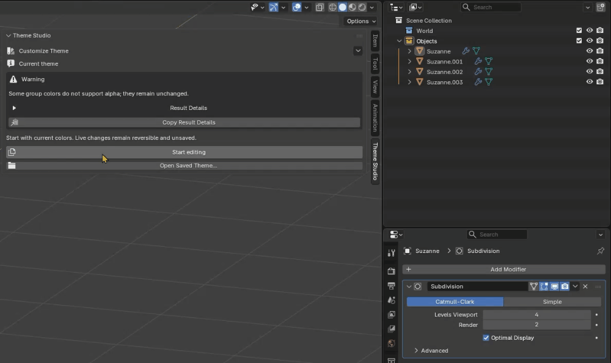
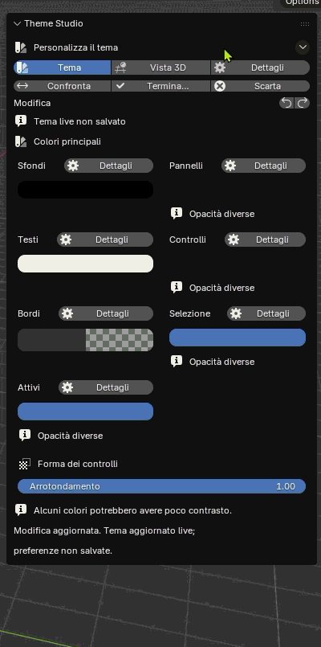
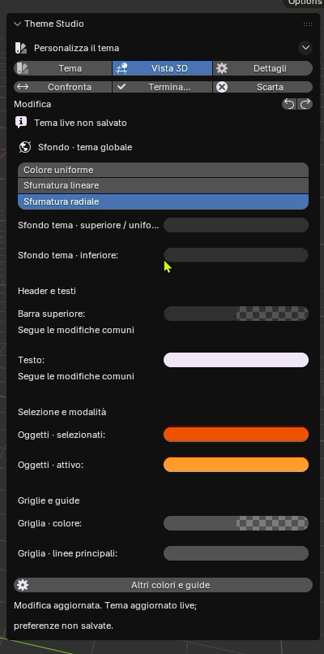

<p>
  
</p>

<p><strong>English</strong> · <a href="README.it.md">Italiano</a></p>

# Blender Theme Studio

## Shape Blender’s interface, your way.

Make Blender’s extensive theme controls easier to explore. Theme Studio groups related colors by purpose, lets you adjust them live, and keeps each editing session reversible.



The hero capture is from a Blender 5.3.0 Beta build; it does not establish compatibility for this localized release on 5.3.

## Download the preview

[**Download Theme Studio 0.4.0 for Blender 5.2.1 LTS**](https://github.com/charliepvc/blender-theme-studio/releases/download/v0.4.0/theme_studio-0.4.0.zip) · [Release notes and known limitations](https://github.com/charliepvc/blender-theme-studio/releases/tag/v0.4.0)

**Preview release.** Install the ZIP from Blender’s add-on preferences; this is a local legacy add-on, not a Blender Extension. The reference build is Blender **5.2.1 LTS**.

## See Theme Studio in action

The 30-second demonstration shows linked-color editing, immediate interface updates, detailed adjustments, and session controls.



## A more direct way to shape Blender’s colors

### Work with related colors

Adjust curated groups such as backgrounds, panels, text, controls, borders, and selection together. Open Details when you need to work with individual fields.

### See changes as you make them

Edits update Blender’s global theme live. Compare the initial theme with your current changes, and use Theme Studio’s undo and redo controls during the session.

### Keep control of the outcome

Discard changes to restore fields still owned by the session while preserving detected external edits. Or finish while keeping the live theme. Save a separate theme copy when you want a file to reopen later.

## Inside Blender

These authentic captures show Theme Studio with Blender’s Italian interface. English is the add-on’s default; Italian is available through Blender’s native translation settings. The colors shown are examples, not bundled presets.

**Theme controls** — Adjust related interface colors and control roundness.



**3D View controls** — Adjust viewport backgrounds, headers, text, selection, and guides.



## Install

1. Download [`theme_studio-0.4.0.zip`](https://github.com/charliepvc/blender-theme-studio/releases/download/v0.4.0/theme_studio-0.4.0.zip). Do not use GitHub’s automatically generated source archive.
2. In Blender, open **Edit → Preferences → Add-ons** and choose **Install from Disk**.
3. Select the downloaded ZIP and enable **Theme Studio** in the add-ons list.
4. In the 3D View, press **N** to open the sidebar. Choose **Theme Studio**, then **Start editing**.

Theme Studio currently lives in the 3D View sidebar. Its pages are **Theme**, **3D View**, and **Details**. The interface defaults to English. To use the supplied Italian translation, select Italian and enable Blender’s **Interface** translation; tooltip translation follows its separate Blender setting.

## Compatibility

| Blender version | Status |
| --- | --- |
| **5.2.1 LTS** | Reference build; localized release ZIP installation and core workflows verified. |
| **5.3.x** | Development family. Earlier checks covered specific Beta builds; this localized release was not re-verified on 5.3. |
| **Other versions** | Not verified. Catalog fallback based on Blender version does not establish compatibility. |

## Important: how theme changes work

- **Changes are global.** Other Blender editors reflect theme edits while a session is active.
- **Hiding the N-panel does not end a session.** Finish or discard the session before closing Blender.
- **Discard and Finish do different things.** **Discard changes…** attempts to restore session-owned fields and reports conflicts; detected external changes are preserved. **Finish…** lets you keep the live theme, with or without an explicit save.
- **Theme Studio does not automatically save Blender preferences.** **Save all preferences…** writes all Blender preferences, not just the theme. Avoid Blender’s manual preference save during a temporary preview.
- **Keeping without saving is not permanent storage.** Blender’s auto-save may save the live theme later if enabled. Recovery data can help after an interruption, but recovery is not guaranteed. Keep a separate theme copy for important work.

## Feedback

[Report a bug or suggest an improvement in GitHub Issues](https://github.com/charliepvc/blender-theme-studio/issues). For useful bug reports, include Blender version and build hash, Theme Studio version, operating system, steps to reproduce, and expected versus actual results. Screenshots or the exact error message can help. Remove personal information; do not upload Blender preferences or private recovery files.

Feedback on linked color groups is especially useful: describe which colors you changed and what result you expected.

## Documentation and development

- [User guide (Italian)](docs/user/README.md)
- [Roadmap (Italian)](ROADMAP.md)
- [All releases and release notes](https://github.com/charliepvc/blender-theme-studio/releases)
- [Source build instructions](#build-from-source)
- [GPL-3.0 license](LICENSE)

### Build from source

This repository’s builder creates a local legacy add-on ZIP. It does not create a Blender Extension. Create the output directory first; the builder refuses to overwrite an existing file.

```bash
python -c "from pathlib import Path; Path('dist').mkdir(exist_ok=True)"
python tools/build_dev_addon.py --output dist/theme_studio-0.4.0.zip
```

## License

Theme Studio is distributed under the [GNU General Public License v3.0](LICENSE).
