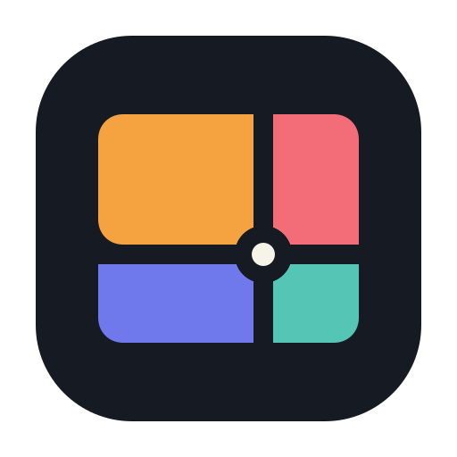
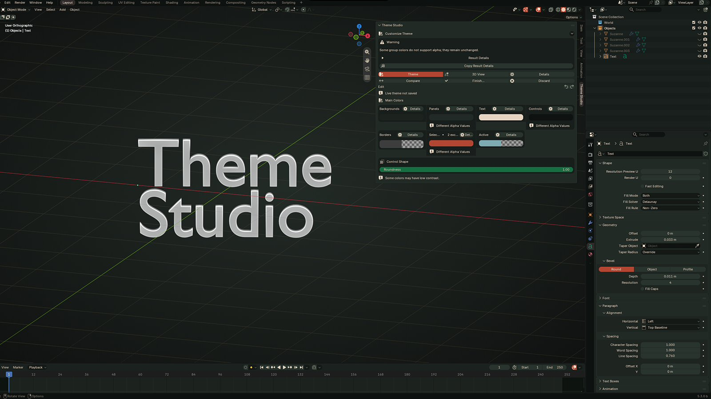
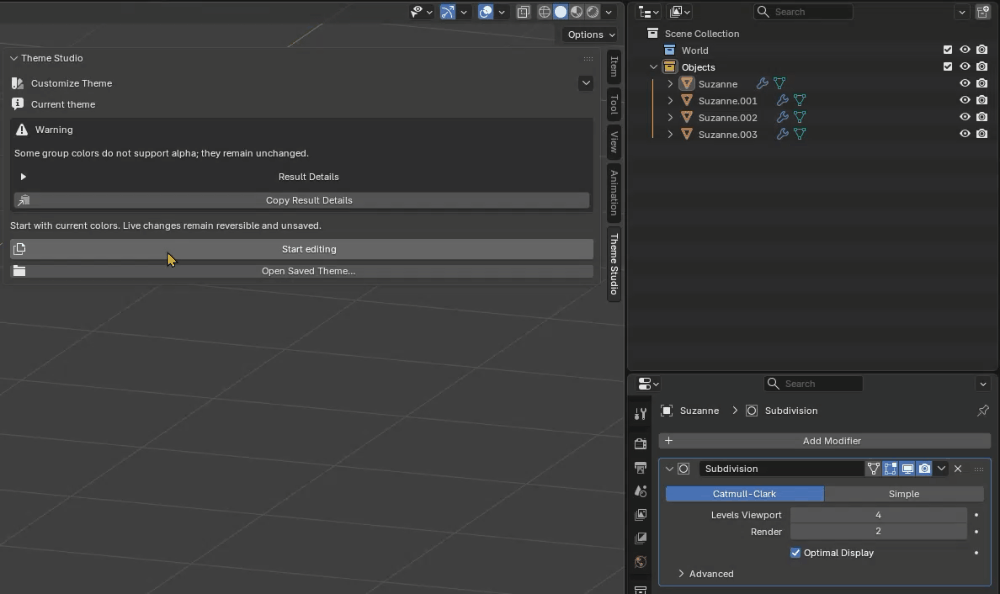
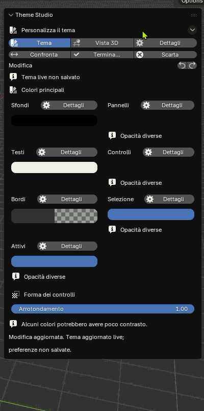
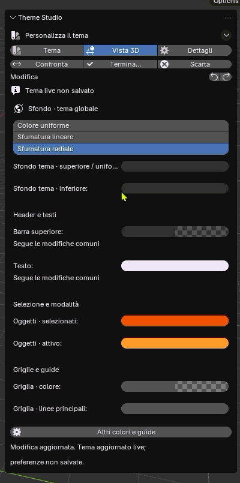

<p>
  
</p>

<p><strong>English</strong> · <a href="README.it.md">Italiano</a></p>

# Blender Theme Studio

## Shape Blender’s interface, your way.

Make Blender’s extensive theme controls easier to explore. Theme Studio groups related colors by purpose, lets you adjust them live, and keeps each editing session reversible.



The hero capture is from a Blender 5.3.0 Beta build; it does not establish compatibility for this localized release on 5.3.

## Download the preview

[**Download Theme Studio 0.5.0 for Blender 5.2.1 LTS**](https://github.com/charliepvc/blender-theme-studio/releases/download/v0.5.0/theme_studio-0.5.0.zip) · [Release notes and known limitations](https://github.com/charliepvc/blender-theme-studio/releases/tag/v0.5.0)

**Preview release.** Install the ZIP from Blender’s add-on preferences; this is a local legacy add-on, not a Blender Extension. The reference build is Blender **5.2.1 LTS**.

## See Theme Studio in action

The 30-second demonstration shows linked-color editing, immediate interface updates, detailed adjustments, and session controls.



## A more direct way to shape Blender’s colors

### Work with related colors

Adjust curated groups such as backgrounds, panels, text, controls, borders, and selection together. Open Details when you need to work with individual fields.

**New in v0.5:** Seven common controls coordinate
surfaces, text and interaction states while preserving individual overrides.
Derived text may differ from the chosen RGB, including gray when black is
selected. New editable copies disable only text shadows; loaded profiles keep
their saved appearance. See the [user guide](docs/user/README.md#common-colors-and-known-limits)
and [roadmap](ROADMAP.md) for behavior and remaining limits.

Version 0.5 offers N-panel, Hybrid (default), and Preferences →
Themes workspace modes in the add-on's properties. Category/context Details share
one session across modes. The experimental picker is shelved and inactive.
Upgrade from v0.4.0 to use these features; older installed ZIPs are not updated automatically.

### See changes as you make them

Edits update Blender’s global theme live. Compare the initial theme with your current changes, and use Theme Studio’s undo and redo controls during the session.

### Keep control of the outcome

Discard changes to restore fields still owned by the session while preserving detected external edits. Or finish while keeping the live theme. Save a separate theme copy when you want a file to reopen later.

Version 0.5 includes named native XML save, native preset loading and
XML copy export, separate from editable Theme Studio projects. Saving writes to
the selected library's `themes` folder and Blender's user presets.
See the [user guide](docs/user/README.md#save-and-load-native-blender-themes)
for scope and limitations.

## Inside Blender

These authentic captures show Theme Studio with Blender’s Italian interface. English is the add-on’s default; Italian is available through Blender’s native translation settings. The colors shown are examples, not bundled presets.
The captures predate v0.5; workspace placement and session controls have changed.

**Theme controls** — Adjust related interface colors and control roundness.



**3D View controls** — Adjust viewport backgrounds, headers, text, selection, and guides.



## Install

1. Download [`theme_studio-0.5.0.zip`](https://github.com/charliepvc/blender-theme-studio/releases/download/v0.5.0/theme_studio-0.5.0.zip). Do not use GitHub’s automatically generated source archive.
2. In Blender, open **Edit → Preferences → Add-ons** and choose **Install from Disk**.
3. Select the downloaded ZIP and enable **Theme Studio** in the add-ons list.
4. In the 3D View, press **N** to open the sidebar. Choose **Theme Studio**, then **Start editing**.

Hybrid is the default: common controls appear in the 3D View sidebar; **Full Workspace** opens **Preferences > Themes** with **Theme**, **3D View**, and **Details** pages. Choose another **Workspace** under **Preferences > Add-ons > Theme Studio**. The interface defaults to English. To use Italian, select Italian and enable Blender’s **Interface** translation; tooltip translation follows its separate setting.

## Compatibility

| Blender version | Status |
| --- | --- |
| **5.2.1 LTS** | Reference build; localized release ZIP installation and core workflows verified. |
| **5.3.x** | Experimental development family; v0.5.0 is not verified on 5.3. |
| **Other versions** | Not verified. Catalog fallback based on Blender version does not establish compatibility. |

Version 0.5 was checked on 5.2.1 LTS `9e2066aef7ef`. Checks do not certify every
rendered context or real-crash recovery; see the release notes for evidence limits.

## Important: how theme changes work

- **Changes are global.** Other Blender editors reflect theme edits while a session is active.
- **Hiding the N-panel does not end a session.** Finish or discard the session before closing Blender.
- **Finish controls the session outcome.** **Finish…** makes save-and-finish the primary action; expand alternatives to keep without saving or discard. Discard attempts to restore session-owned fields and preserves detected external changes.
- **Theme Studio does not automatically save Blender preferences.** **Save all preferences…** writes all Blender preferences, not just the theme. Avoid Blender’s manual preference save during a temporary preview.
- **Keeping without saving is not permanent storage.** Blender’s auto-save may save the live theme later if enabled. Recovery data can help after an interruption, but recovery is not guaranteed. Keep a separate theme copy for important work.

## Feedback

[Report a bug or suggest an improvement in GitHub Issues](https://github.com/charliepvc/blender-theme-studio/issues). For useful bug reports, include Blender version and build hash, Theme Studio version, operating system, steps to reproduce, and expected versus actual results. Screenshots or the exact error message can help. Remove personal information; do not upload Blender preferences or private recovery files.

Feedback on linked color groups is especially useful: describe which colors you changed and what result you expected.

## Documentation and development

- [User guide (English)](docs/user/README.md) · [Italiano](docs/user/README.it.md)
- [Roadmap (English)](ROADMAP.md) · [Italiano](ROADMAP.it.md)
- [All releases and release notes](https://github.com/charliepvc/blender-theme-studio/releases)
- [Source build instructions](#build-from-source)
- [GPL-3.0 license](LICENSE)

### Build from source

This repository’s builder creates a local legacy add-on ZIP. It does not create a Blender Extension. Create the output directory first; the builder refuses to overwrite an existing file.

```bash
python -c "from pathlib import Path; Path('dist').mkdir(exist_ok=True)"
python tools/build_dev_addon.py --output dist/theme_studio-0.5.0-dev.zip
```

## License

Theme Studio is distributed under the [GNU General Public License v3.0](LICENSE).
